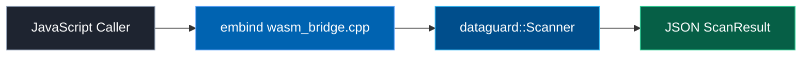

# API Reference

## WebAssembly JavaScript API (`data_guard.js`)

Load the Emscripten module with `const wasm = await createDataGuardModule();`.

### `wasm.scanText(text, policyJson) -> string`
Scans `text` against `policyJson` (or `""` for Enterprise defaults) and returns a JSON string:
```json
{
  "blocked": true,
  "riskScore": 40,
  "findingCount": 1,
  "redactedText": "key=[REDACTED:SEC-AWS-KEY]",
  "findings": [
    {
      "ruleId": "SEC-AWS-KEY",
      "category": "SECRET",
      "severity": "CRITICAL",
      "description": "AWS Access Key ID",
      "maskedMatch": "AKIA****CDEF",
      "start": 4,
      "end": 24,
      "line": 1,
      "column": 5,
      "entropy": 4.08
    }
  ]
}
```

### `wasm.redactText(text, policyJson) -> string`
Returns only the redacted text according to `policy.redactionMode` (`PLACEHOLDER`, `MASK`, or `REMOVE`).

### `wasm.getDefaultPolicy() -> string`
Returns the formatted default Enterprise `policy.json`.

### `wasm.validatePolicy(policyJson) -> string`
Returns `{"valid": true, "errors": []}` or `{"valid": false, "errors": ["..."]}`.

### `wasm.getVersion() -> string`
Returns the scanner engine version (`"1.0.0"`).

## C++ Core API (`dataguard`)

- `dataguard::Scanner::scan(const std::string& input) -> ScanResult`
- `dataguard::Scanner::redact(const std::string& input) -> std::string`
- `dataguard::Policy::fromJson(const std::string& json, std::string& err) -> Policy`
- `dataguard::Policy::validate(std::vector<std::string>& errors) const -> bool`

## Visual Architecture


