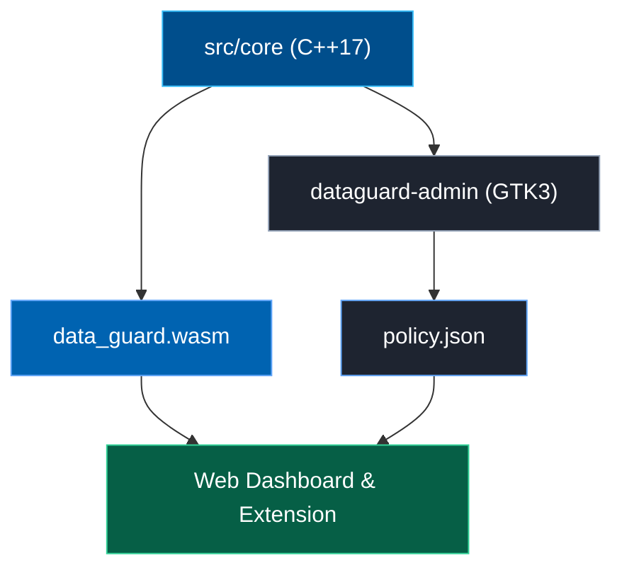

# Architecture

## High-Level Design

Enterprise Data Guard uses a **single-engine, dual-target C++17 architecture**. The exact same detection, validation, policy, and redaction logic runs both natively in the Admin Control Centre and inside every user's browser via WebAssembly.

```
                  +-----------------------------------+
                  |        src/core/ (C++17)          |
                  |  scanner, policy, validators, json|
                  +----------------+------------------+
                                   |
           +-----------------------+-----------------------+
           | (Emscripten em++)                             | (g++ / CMake)
           v                                               v
+------------------------+                     +------------------------+
|  dist/wasm/            |                     |  build/native/         |
|  data_guard.wasm + .js |                     |  dataguard-admin (GTK3)|
+-----------+------------+                     +-----------+------------+
            |                                              |
            v                                              | exports policy.json
+------------------------+                                 |
|  web/ User Dashboard   | <-------------------------------+
|  & interceptor.js      |
+------------------------+
```

## Components

| Component | Path | Purpose |
| :--- | :--- | :--- |
| Core JSON | `src/core/json.{hpp,cpp}` | Zero-dependency JSON parser and serializer |
| Validators | `src/core/validators.{hpp,cpp}` | Luhn, IBAN mod-97, SSN, Shannon entropy, masking |
| Policy | `src/core/policy.{hpp,cpp}` | Policy schema, validation, JSON serialization |
| Scanner | `src/core/scanner.{hpp,cpp}` | Regex + validator + entropy scanning & redaction |
| WASM Bridge | `src/wasm/wasm_bridge.cpp` | Emscripten `embind` exports for JS |
| Admin Controller | `src/admin_gui/admin_controller.{hpp,cpp}` | Policy file I/O, rule management, headless CLI |
| Admin GTK3 GUI | `src/admin_gui/main.cpp` | Native desktop Admin Control Centre |
| Web Dashboard | `web/` | Client-side pre-flight prompt scanner UI |

## Visual Architecture


