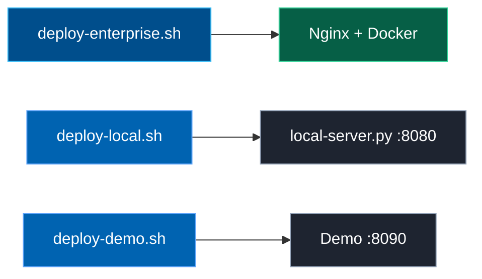
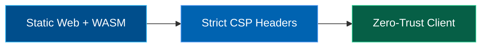

# Deployment Guide

Three automated deployment scripts are provided in `scripts/`.

## 1. Enterprise Deployment (`scripts/deploy-enterprise.sh`)

Builds the C++ Admin binary, compiles `data_guard.wasm`, exports `policy.json`, and packages a read-only Nginx + Docker Compose bundle:

```bash
./scripts/deploy-enterprise.sh          # Assemble dist/enterprise/
./scripts/deploy-enterprise.sh --up     # Assemble and start via docker compose
```

Artifacts created in `dist/enterprise/`:
- `Dockerfile`, `docker-compose.yml`, `nginx.conf` (strict CSP, `application/wasm` MIME type, no-cache `policy.json`)
- `bundle/` (static web dashboard, `data_guard.wasm`, and `policy.json`)

## 2. Local Deployment (`scripts/deploy-local.sh`)

Builds and installs the native GTK3 Admin GUI binary and static web dashboard into `dist/local/` and starts the local Python WASM-aware server on `http://127.0.0.1:8080`:

```bash
./scripts/deploy-local.sh               # Build, install, and serve on port 8080
./scripts/deploy-local.sh --port=9000   # Serve on custom port
./scripts/deploy-local.sh --no-serve    # Build and install only
```

## 3. Demo Deployment (`scripts/deploy-demo.sh`)

Builds the project, runs a live CLI demonstration scan, packages `demo-scenarios.json`, and serves the interactive web dashboard on `http://127.0.0.1:8090`:

```bash
./scripts/deploy-demo.sh                # Prepare demo and serve on port 8090
./scripts/deploy-demo.sh --no-serve     # Prepare demo and run CLI scan only
```

## Visual Architecture




