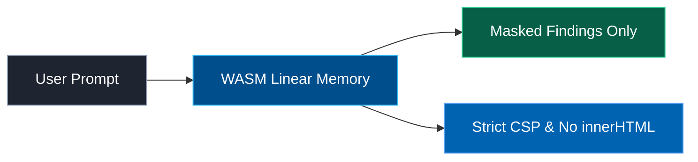

# Security Model

## Zero-Trust Client-Side Scanning

- **No Prompt Telemetry**: Prompts, code snippets, and scan findings never leave the user's browser. All scanning executes inside WebAssembly linear memory (`data_guard.wasm`).
- **Masked Findings**: `ScanResult` returns `maskedMatch` (e.g., `AKIA****CDEF`) rather than raw secret values in findings metadata.
- **Strict Content Security Policy**: Both `web/index.html` and `deploy/enterprise/nginx.conf` enforce `default-src 'self'; script-src 'self' 'wasm-unsafe-eval'; connect-src 'self';` and XSS-safe DOM rendering (`textContent` only).
- **Read-Only Enterprise Container**: `deploy/enterprise/docker-compose.yml` mounts the Nginx container root filesystem read-only with `tmpfs` for runtime state.

## Detection Coverage

- **Secrets (`SECRET`)**: AWS Access Keys, GitHub PATs, OpenAI Keys, Anthropic Keys, Google API Keys, Stripe Live Keys, Slack Tokens, PEM Private Keys, JWTs, Database URIs with credentials, Hardcoded Password/API-Key Assignments, High-Entropy Bearer Tokens.
- **Personal Data (`PII`)**: Luhn-validated Payment Card Numbers, US SSNs, Mod-97-validated IBANs, Email Addresses, Phone Numbers, and optional IPv4 Addresses.

## Visual Architecture

