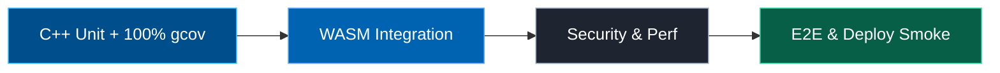

# Testing and Coverage

## Running the Full Suite

```bash
./scripts/run-tests.sh
```

This executes three verification stages:

1. **C++ Unit Tests & 100% `gcov` Line Coverage (`tests/cpp/` + `scripts/check-coverage.py`)**:
   - Compiles `dataguard_core` and `dataguard_admin_lib` with `--coverage -O0 -g`.
   - Runs `ctest` (`dataguard_tests`).
   - Invokes `gcov` and verifies **100.00% line coverage** across:
     - `src/core/json.cpp`
     - `src/core/validators.cpp`
     - `src/core/policy.cpp`
     - `src/core/scanner.cpp`
     - `src/admin_gui/admin_controller.cpp`
2. **WebAssembly Integration Tests (`tests/wasm/test_wasm.mjs`)**:
   - Compiles `data_guard.js` + `data_guard.wasm` via `em++` and verifies `scanText`, `redactText`, `getDefaultPolicy`, `validatePolicy`, and `getVersion` in Node.js.
3. **Deployment Script Smoke Tests (`tests/deploy/test_deploy_scripts.sh`)**:
   - Verifies Enterprise, Local, and Demo deployment scripts produce all required artifacts.

## Visual Architecture


