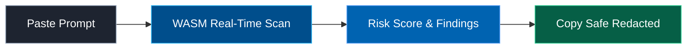

# Web Dashboard Guide

The **Web Dashboard** (`web/index.html`) gives every user a zero-trust pre-flight prompt inspector running 100% in their browser via `data_guard.wasm`.

## Features

- **Real-Time Prompt & Code Scanning**: Paste text or code; scanning runs locally in WebAssembly memory with zero network calls.
- **One-Click Safe Redaction**: Copy the redacted prompt (`[REDACTED:RULE_ID]`, masked, or removed) directly to the clipboard before pasting into any AI tool.
- **Policy Sync & Import**: Automatically loads `./policy.json` (deployed by Enterprise/Local scripts) or allows importing an admin-exported `policy.json`.
- **AI Tool Interceptor (`web/interceptor.js`)**: Click **AI Tool Interceptor** in the header to view/copy the client-side script that intercepts `Enter` submissions on web inputs when secrets or PII are detected.

## Visual Architecture

