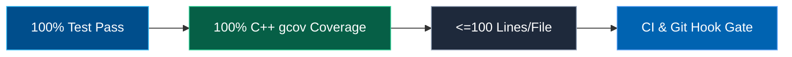

# Project Metrics

Updated: 2026-11-20 22:48:51 UTC

## Line-Count Report

| Group | Files | Lines |
| :--- | ---: | ---: |
| C++ Source (.cpp/.hpp) | 37 | 2059 |
| JavaScript / WASM Glue (.js/.mjs) | 12 | 680 |
| CSS & HTML (.css/.html/.svg) | 12 | 659 |
| Scripts & Build (.sh/.py/CMake/Docker/Conf) | 17 | 825 |
| JSON Data & Manifests (.json) | 3 | 91 |
| Documentation (.md) | 19 | 1167 |
| C++ Unit Tests | 10 | 552 |
| WASM / Perf / Security / E2E / Deploy Tests | 5 | 152 |
| **Total Project** | **115** | **6185** |
