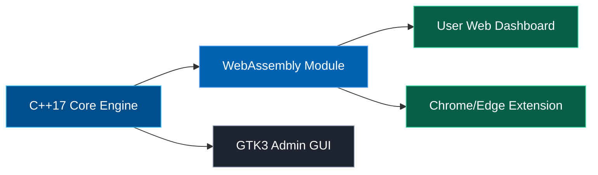
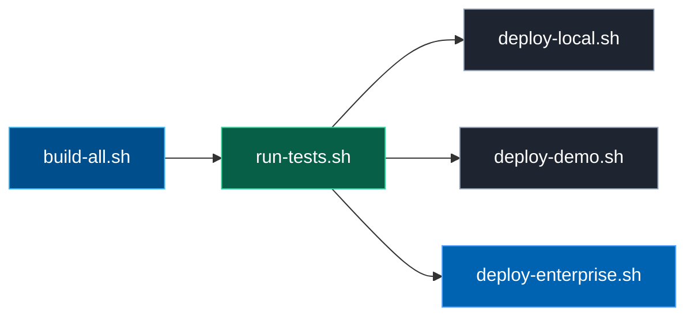

# Enterprise Data Guard

**Client-side C++ / WebAssembly secret and personal-data scanner that prevents API keys, credentials, and customer PII from leaking into AI prompts.**

## Overview

Developers and employees routinely paste stack traces, configuration files, database URIs, and customer records into AI assistants. **Enterprise Data Guard** solves this before a single byte leaves the browser:

1. **Core C++17 Scanner Engine (`src/core/`)**: Detects secrets (AWS, GitHub, OpenAI, Anthropic, Google, Stripe, Slack, PEM private keys, JWTs, database URIs, high-entropy Bearer tokens) and personal data (Luhn-validated credit cards, US SSNs, mod-97 validated IBANs, emails, phone numbers, optional IPv4).
2. **WebAssembly Browser Module (`src/wasm/`)**: Compiled with Emscripten (`em++`) to `data_guard.wasm` so scanning and redaction execute 100% locally in the user's browser.
3. **C++ Admin Control Centre (`src/admin_gui/`)**: Native GTK+ 3 desktop application (with headless CLI mode) sharing the exact same C++ core engine to configure policies, manage allowlists/custom rules, test scans, and export `policy.json`.
4. **Web Dashboard for Every User (`web/`)**: Zero-trust browser dashboard and `interceptor.js` prompt guard powered by `data_guard.wasm`.
5. **Automated Deployment Scripts (`scripts/`)**:
   - **Enterprise** (`scripts/deploy-enterprise.sh`): Docker + Nginx static bundle + enterprise `policy.json`.
   - **Local** (`scripts/deploy-local.sh`): Native Admin GUI + local Python WASM server.
   - **Demo** (`scripts/deploy-demo.sh`): Pre-loaded scenarios + live CLI/web demo.

## Quick Start

```bash
# Build native C++ core, GTK3 Admin GUI, and WebAssembly bundle
./scripts/build-all.sh

# Run C++ unit tests, 100% gcov coverage check, WASM tests, and deploy smoke tests
./scripts/run-tests.sh

# Launch the C++ GTK3 Admin Control Centre
./build/native/dataguard-admin

# Start Local or Demo web dashboard
./scripts/deploy-local.sh
./scripts/deploy-demo.sh
```

## Documentation

- [Architecture](docs/architecture.md)
- [API Reference](docs/api-reference.md)
- [Admin GUI Guide](docs/admin-gui-guide.md)
- [Web Dashboard Guide](docs/web-dashboard-guide.md)
- [Deployment Guide](docs/deployment-guide.md)
- [Security Model](docs/security-model.md)
- [Testing and Coverage](docs/testing-and-coverage.md)

## Visual Architecture




