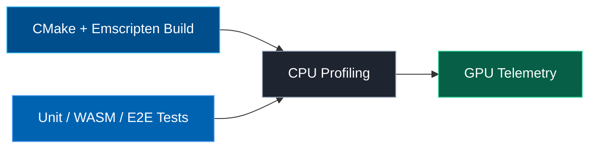

# System Profile (CPU & GPU)

Updated: 2026-11-20 22:48:51 UTC

| Resource | Snapshot |
| :--- | :--- |
| CPU Model | 11th Gen Intel(R) Core(TM) i5-1135G7 @ 2.40GHz |
| Logical Cores | 8 |
| Memory Used / Total | 9.0Gi / 15Gi |
| GPU Telemetry | NVIDIA GeForce MX330, 0 %, 5 MiB, 2048 MiB |
